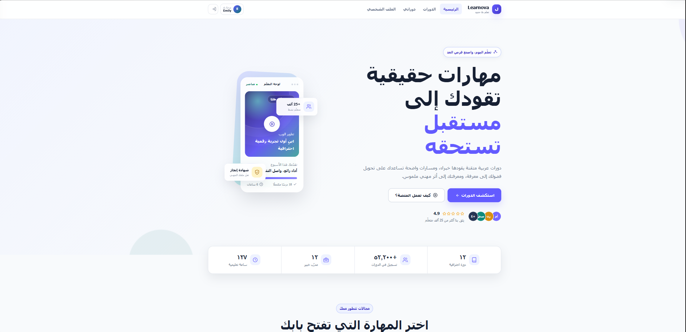
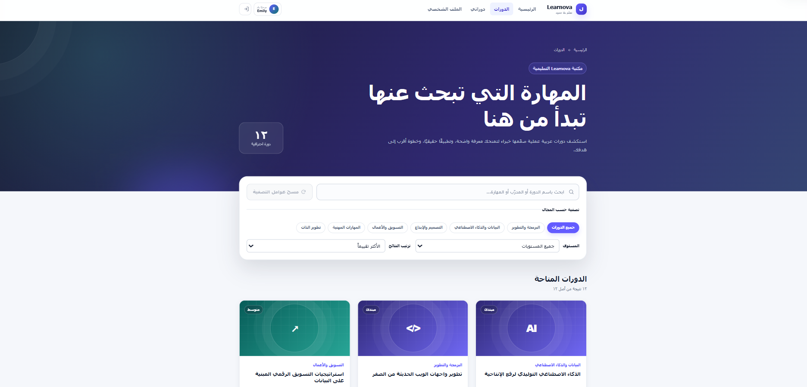
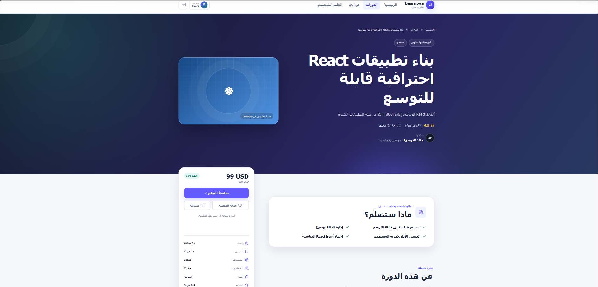
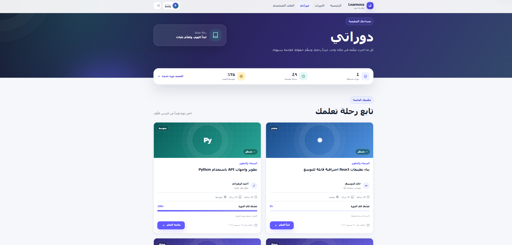

# Learnova

An Arabic RTL learning-platform demonstration built with React and Vite. Learnova brings together course discovery, demo authentication, enrollment, and a lesson workspace with browser-local progress tracking.

This is a frontend portfolio project. It uses DummyJSON for authentication demonstrations and browser storage for local accounts, enrollment, and learning progress; it has no custom production backend.

## Features

- Arabic right-to-left interface with responsive desktop, tablet, and mobile layouts.
- Course search, category/level filters, and sorting persisted in URL query parameters.
- Course details with curriculum, outcomes, requirements, instructor information, and related courses.
- Authentication Context, reusable auth fields, validation, and loading/error states.
- Protected routes that return users to their intended page after login.
- Per-user enrollment with duplicate prevention in browser storage.
- Lesson navigation, completion tracking, resume links, and a My Courses dashboard.
- Profile summaries derived from local enrollment/progress data and local demo display-name editing.
- Reusable components, shared CSS tokens, keyboard interactions, and reduced-motion styles.

## Technology stack

React 19 · JavaScript · React Router 7 · Context API · Axios · Vite · custom responsive CSS · LocalStorage · ESLint

The UI does not depend on Tailwind CSS, Bootstrap, or an external component library.

## Architecture

```text
src/
├── components/   Reusable layout, course, auth, learning, and profile UI
├── context/      Authentication state and actions
├── data/         Local course dataset
├── hooks/        Shared React hooks
├── pages/        Route-level pages and styles
├── routes/       Routes and access guards
├── services/     API, authentication, enrollment, progress, and storage
├── styles/       Shared styles and design tokens
└── utils/        Catalog, validation, and navigation helpers
```

```text
Pages/components → Auth Context / services
                              ├── Axios → DummyJSON (demo identity)
                              ├── courseService → local course dataset
                              └── storage services → LocalStorage
```

Course records originate in `src/data/courses.js`; components access them through `courseService.js`.

## Authentication demonstration

| Endpoint | Role in the demonstration |
| --- | --- |
| `POST /auth/login` | Sign in with an existing DummyJSON demo account |
| `GET /auth/me` | Validate and restore a remote session |
| `GET /users/filter` | Resolve an email address to a demo username |
| `POST /users/add` | Simulate registration before saving a local demo account |

DummyJSON does not persist newly added users. After a successful registration request, Learnova keeps a local demo account on the current browser/device. Local passwords are stored as salted SHA-256 hashes, not plaintext; this remains a demonstration rather than production password storage. Use disposable demo credentials, not personal passwords.

Remote sessions are checked through `/auth/me`. Local demo sessions use locally stored users. If remote restoration encounters a network failure without an HTTP response, the current implementation retains the stored demo session.

`/my-courses`, `/profile`, and `/learn/*` require authentication. Learning routes also check local course enrollment. These are client-side navigation guards, not server-side authorization.

## Browser-local data

| Storage key | Contents |
| --- | --- |
| `coursePlatform.auth` | Current user and access token |
| `coursePlatform.localUsers` | Local demo accounts, salts, and password hashes |
| `coursePlatform.enrollments` | Per-user course enrollment records |
| `coursePlatform.learningProgress` | Completed lesson IDs and last visited lesson per user/course |

Clearing site data removes local accounts, enrollments, and progress. Data does not synchronize between browsers or devices. Courses, enrollment, and progress are not fetched from DummyJSON.

## Local installation

**Setup status:** commands and runtime requirements were checked against the manifests/lockfile, but were not executed in a clean environment during this documentation pass.

Requirements: Node.js 22.13+ within the 22.x line, or Node.js 24+, and npm. These choices satisfy the checked Vite and ESLint engine requirements.

```bash
git clone https://github.com/mustafa-baaj1/my-react-app.git
cd my-react-app
npm ci
npm run dev
```

Open the URL printed by Vite. The checked demo requires no environment variables or private API key; network access to DummyJSON is needed for its remote authentication flow.

## Development commands

```bash
npm run dev      # Development server
npm run lint     # ESLint
npm run build    # Bundle into dist/
npm run preview  # Local preview of the bundle
```

No automated test suite is configured. No lint/build pass or test coverage is claimed in this documentation update.

## Static hosting configuration

The build output is `dist/`. Browser-history routes need a host fallback to `index.html` for application paths. The repository includes `public/_redirects` and `vercel.json` for compatible hosting configurations. These files do not establish that a live deployment exists; no deployment URL is claimed.

## Screenshots

Genuine captures of the Arabic RTL interface. The screenshots use demonstration content: course ratings, prices, and landing-page counters are illustrative, not verified usage metrics. Enrollment and progress shown here are browser-local demo state.

**Homepage** — the main landing-page layout and RTL navigation.

[](docs/screenshots/homepage.png)

<details>
<summary>View course catalog, course details, and learning progress</summary>

**Course catalog** — search, category/level filters, and sorting controls.

[](docs/screenshots/course-catalog.png)

**Course details** — course overview, outcomes, and enrollment action.

[](docs/screenshots/course-details.png)

**My Courses** — enrolled-course cards and browser-local progress states.

[](docs/screenshots/learning-progress.png)

</details>

Select an image to view the original-resolution capture. These screenshots demonstrate the frontend interface, not a custom production backend.

## Demo limitations

- No production backend, server-enforced access control, or cross-device persistence.
- DummyJSON availability and demo-account behavior affect remote authentication.
- LocalStorage tokens/accounts are for demonstration, not a production security architecture.
- Course videos are placeholders; no streaming integration is implemented.
- Favorites provide session-only UI feedback and are not persisted.
- Recent activity derives from enrollment and latest progress timestamps, not a complete event log.
- Landing-page statistics/testimonials are demonstration content, not verified usage metrics.
- Responsive and accessibility behavior still benefits from browser and assistive-technology testing.
